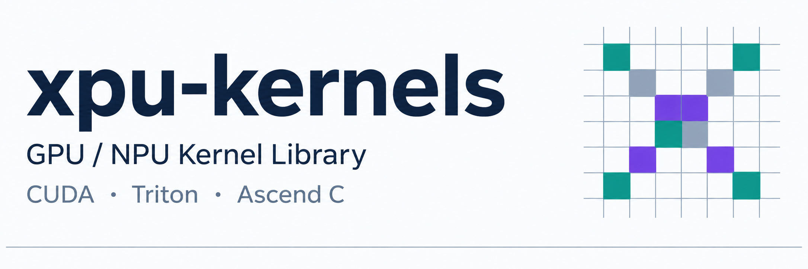
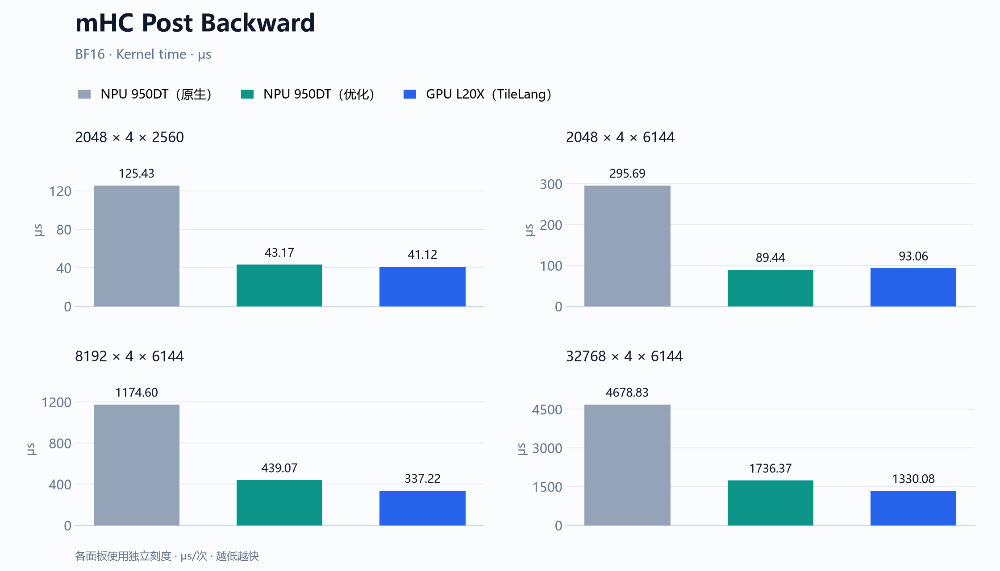

<div align="center">



[安装与使用](#quick-start) &nbsp;·&nbsp; [算子](#operators) &nbsp;·&nbsp; [性能](#benchmarks) &nbsp;·&nbsp; [复现](docs/benchmarking.md)

</div>

NVIDIA GPU 与昇腾 NPU 算子库，面向训练和推理中的高性能张量算子。提供统一 Python API、设备实现、独立数值参考与可复现的正确性和性能测量。

<a id="quick-start"></a>

## 安装与最小示例

```bash
git clone --recurse-submodules https://github.com/JPWang-CS/xpu-kernels.git
cd xpu-kernels
python -m pip install -e '.[gpu,mhc-gpu,dev]'  # NVIDIA GPU，含 mHC
```

昇腾 NPU 环境先手动 source 所选 CANN，再执行 `python -m pip install -e '.[dev]'`。依赖、工具链与构建说明见[安装指南](docs/getting-started.md)。

```python
import torch
from xpu_kernels import rms_norm

x = torch.randn(128, 4096, device="cuda", dtype=torch.bfloat16)
weight = torch.ones(4096, device=x.device, dtype=x.dtype)
y = rms_norm(x, weight)
```

<a id="operators"></a>

## 算子

**RMSNorm** 沿最后一维归一化并应用权重，适用于 GPU 与昇腾 NPU 工作负载。见 [RMSNorm 完整文档](docs/operators/rmsnorm.md)。

**mHC Post Backward** 计算残差混合过程的四个梯度，提供 GPU 与昇腾 NPU 实现。

<a id="benchmarks"></a>

## 性能

优化实现后续可能合入 CANN 上游。NPU 性能对比以测试时 CANN 包内的主线算子为基线。

<!-- BEGIN homepage-performance -->
### mHC Post Backward



[mHC Post Backward 完整文档](docs/operators/mhc-post-backward.md)
<!-- END homepage-performance -->

## License

公共代码采用 [Apache-2.0](LICENSE)；DeepSeek TileKernels GPU 源码保留随附的 [MIT License](src/xpu_kernels/backends/_tilekernels/LICENSE)；mHC NPU 内核与成本模型保留 [CANN Open Software License 2.0](kernels/include/xpu_kernels/mhc_post_backward/LICENSE)。NPU JIT 运行时使用 [DeepJIT](https://github.com/deepseek-ai/DeepJIT)。[第三方说明](THIRD_PARTY_NOTICES.md)
