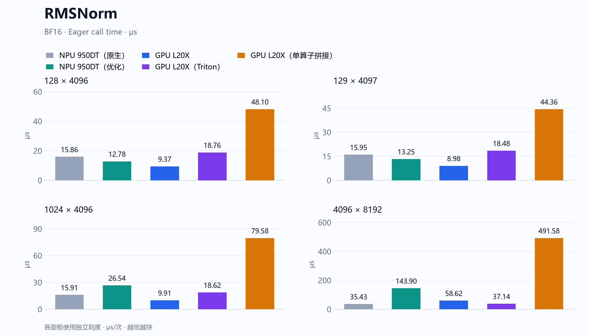

<div align="center">


[安装与使用](#quick-start) &nbsp;·&nbsp; [算子](#operators) &nbsp;·&nbsp; [性能](#benchmarks) &nbsp;·&nbsp; [复现](docs/benchmarking.md)

</div>

NVIDIA GPU 与昇腾 NPU 算子库，面向训练和推理中的高性能张量算子。提供统一 Python API、设备实现、独立数值参考与可复现的正确性和性能测量。

<a id="quick-start"></a>

## 安装与最小示例

```bash
git clone --recurse-submodules https://github.com/JPWang-CS/xpu-kernels.git
cd xpu-kernels
python -m pip install -e '.[gpu,mhc-gpu,dev]'  # NVIDIA GPU，含 mHC
```

昇腾 NPU 环境先手动 source 所选 CANN，再执行 `python -m pip install -e '.[dev]'`。依赖、工具链与构建说明见[安装指南](docs/getting-started.md)。

```python
import torch
from xpu_kernels import rms_norm

x = torch.randn(128, 4096, device="cuda", dtype=torch.bfloat16)
weight = torch.ones(4096, device=x.device, dtype=x.dtype)
y = rms_norm(x, weight)
```

<a id="operators"></a>

## 算子

**RMSNorm** 沿最后一维归一化并应用权重，支持 CUDA C++、Triton 与 Ascend C。输入设备决定后端；GPU 默认使用 CUDA C++，也可指定 `implementation="triton"`。见 [RMSNorm 接口、数值约定与运行示例](docs/operators/rmsnorm.md)。

**mHC Post Backward** 计算残差混合过程的四个梯度，GPU 使用 DeepSeek TileKernels 的 TileLang 实现，NPU 提供 Ascend C 实现。函数返回 `(grad_x, grad_h_res, grad_h_out, grad_h_post)`；输入约束、实现映射与运行方式见 [mHC Post Backward 文档](docs/operators/mhc-post-backward.md)。

<a id="benchmarks"></a>

## 性能

<!-- BEGIN homepage-performance -->
每组柱形对应同一个 shape，纵轴为 **μs/次，越低越快**。各面板独立使用从零开始的刻度。

### RMSNorm



BF16，设备 Event / Eager 调用区间。各实现每次调用分配输出，预热 20 次，10 批 × 50 次，取批均值的中位数。

[48 个 shape 的完整结果](docs/performance/README.md) · [公式与接口](docs/operators/rmsnorm.md)

### mHC Post Backward


BF16，NPU 采用 msprof `Task Duration(us)`，GPU 采用 Nsight Compute 内核时间；各 shape 预热 20 次，取 5 次正式采样的中位数。NPU 原生为 CANN 包主线算子，GPU 使用 DeepSeek TileKernels 实现。

[16 个 shape 的完整结果](docs/performance/mhc-post-backward.md) · [公式与接口](docs/operators/mhc-post-backward.md)

[测试与采集方法](docs/benchmarking.md) · [图表数据](docs/assets/performance-chart-data.json)
<!-- END homepage-performance -->

## 性能复现

运行设备正确性测试、复现 benchmark 与采集 profiler，见[Benchmark 与 Profiler 指南](docs/benchmarking.md)。安装包与设备验证记录见[验证报告](docs/validation.md)。

## License

公共代码采用 [Apache-2.0](LICENSE)；DeepSeek TileKernels GPU 源码保留随附的 [MIT License](src/xpu_kernels/backends/_tilekernels/LICENSE)；mHC NPU 内核与成本模型保留 [CANN Open Software License 2.0](kernels/include/xpu_kernels/mhc_post_backward/LICENSE)。NPU JIT 运行时使用 [DeepJIT](https://github.com/deepseek-ai/DeepJIT)。[第三方说明](THIRD_PARTY_NOTICES.md)
