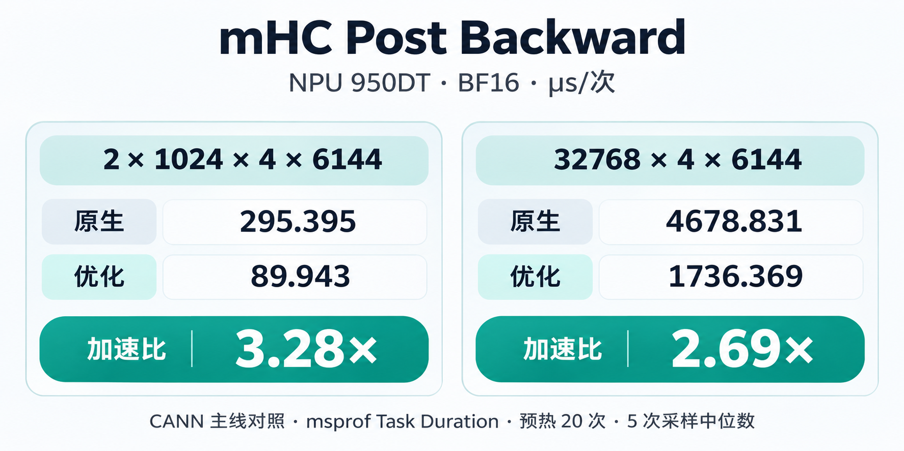
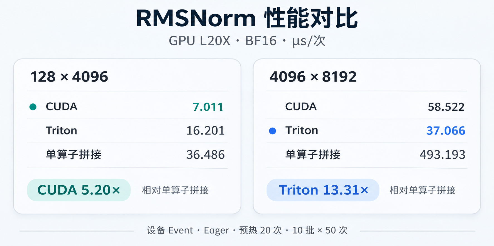

<div align="center">


<p>
  <a href="#operators">算子</a> &nbsp; / &nbsp;
  <a href="#performance">性能</a> &nbsp; / &nbsp;
  <a href="#quick-start">安装</a> &nbsp; / &nbsp;
  <a href="#benchmark">测试与分析</a> &nbsp; / &nbsp;
  <a href="skills/xpu-kernels/SKILL.md">AI Skill</a>
</p>

**CUDA · Triton · Ascend C** &nbsp; | &nbsp; Python API · Golden · Benchmark · Profiler

</div>

GPU 与昇腾 NPU 算子库。每个算子提供可安装接口、独立数值参考、多个 shape 的正确性检查与实测性能。当前代码保留最终实现，原始性能记录用于比较后续迭代。

<a id="operators"></a>

## 算子

| 算子 | GPU | NPU | 精度与实测范围 |
|---|---|---|---|
| **[RMSNorm](docs/performance/README.md)** | CUDA C++ / Triton | Ascend C | FP32、FP16、BF16；48 个 shape |
| **[mHC Post Backward](docs/operators/mhc-post-backward.md)** | — | Ascend C · Cube / Vector | BF16 优化；16 个 TND / BSND shape |

RMSNorm 两端使用同一接口，GPU 默认 CUDA C++，可选 Triton。mHC backward 一次返回四个梯度，在优化范围内使用本库内核，其余受支持输入调用 CANN 原生算子。NPU 内核通过 DeepJIT 编译、加载并缓存，使用当前 PyTorch stream。

<a id="performance"></a>

## 性能

<!-- BEGIN homepage-performance -->
### mHC Post Backward · NPU 950DT



**BF16 · μs/次**。原生为 CANN 9.2.0 B096 的 `aclnnMhcPostBackward`，优化为本库实现。每个 shape 预热 20 次，取 5 次 `msprof Task Duration(us)` 的中位数。

| Shape | 原生 | 优化 |
|---|---:|---:|
| 2048 × 4 × 2560 | 125.430 | **43.167** |
| 2048 × 4 × 6144 | 295.689 | **89.442** |
| 8192 × 4 × 6144 | 1174.600 | **439.071** |
| 32768 × 4 × 6144 | 4678.831 | **1736.369** |
| 2 × 1024 × 4 × 6144 | 295.395 | **89.943** |

优化范围：BF16、4 条残差流、传入 `h_res`，token 数为 2048–49152，特征宽度为 2560、5120、6144 或 7168。其它受支持输入自动调用 CANN 原生实现。

[16 个 shape 与原始采样](docs/performance/mhc-post-backward.md) · [公式与接口](docs/operators/mhc-post-backward.md)

### RMSNorm · GPU L20X



**BF16 · μs/次**。设备 Event，Eager 模式，预热 20 次，测量 10 批、每批 50 次。加粗为同一 GPU 上最低耗时。

| Shape | GPU L20X | GPU L20X（Triton） | GPU L20X（单算子拼接） |
|---|---:|---:|---:|
| 128 × 4096 | **7.011** | 16.201 | 36.486 |
| 129 × 4097 | **7.268** | 16.594 | 37.841 |
| 1024 × 4096 | **9.518** | 16.288 | 82.181 |
| 4096 × 8192 | 58.522 | **37.066** | 493.193 |

单算子拼接在 GPU 上依次执行平方、均值、归一化和权重乘法，各实现保持相同的中间舍入顺序。

<details>
<summary><strong>RMSNorm · NPU 950DT 原生对照</strong></summary>

**BF16 · μs/次**。设备 Event，预热 20 次，10 批 × 50 次，两边每次调用均分配输出。

| Shape | 原生 | 优化 |
|---|---:|---:|
| 128 × 4096 | 15.863 | **12.783** |
| 129 × 4097 | 15.949 | **13.247** |
| 1024 × 4096 | **15.910** | 26.541 |
| 4096 × 8192 | **35.431** | 143.905 |

本库遵循 Pangu 的数值顺序：归一化值先转回输入精度，再乘权重；CANN 原生在融合计算后转回输出精度。两者按各自公式检查。表中保留原生更快的 shape。

</details>

[48 个 shape · GPU 各实现](docs/performance/README.md) · [48 个 shape · NPU 原生对照](docs/performance/rmsnorm-native.md)

GPU 与 NPU 分别测量；Event 区间包含 CPU 提交间隙，kernel 时间采用独立 profiler 数据。
<!-- END homepage-performance -->

<a id="quick-start"></a>

## 安装

需要 Python 3.10+ 和与设备匹配的 PyTorch。保留现有框架和驱动，在项目私有环境中安装：

```bash
git clone --recurse-submodules https://github.com/JPWang-CS/xpu-kernels.git
cd xpu-kernels
```

<table>
<tr><th>NVIDIA GPU</th><th>昇腾 NPU</th></tr>
<tr>
<td>CUDA Toolkit、NVCC、C++20 编译器；Triton 与 PyTorch 匹配。</td>
<td>torch_npu、CANN、C++20 工具链与 Python 开发头文件；先手动 source CANN。</td>
</tr>
</table>

```bash
# GPU
python -m pip install -e '.[gpu,dev]'
python -m xpu_kernels.cli check-env --backend gpu
python -m xpu_kernels.cli build --backend gpu
python -m xpu_kernels.cli example --device cuda

# NPU：先手动 source 已选择的 CANN
python -m pip install -e '.[dev]'
python -m xpu_kernels.cli check-env --backend npu
python -m xpu_kernels.cli build --backend npu
python -m xpu_kernels.cli example --device npu
python -m xpu_kernels.cli example --device npu --operator mhc_post_backward --shape 2x1024x4x6144
```

已有完整依赖时，可用 `python -m pip install --no-deps --no-build-isolation -e .` 保留框架版本。依赖以 [pyproject.toml](pyproject.toml) 为准，`pip install -r requirements.txt` 提供基础安装入口。首次调用会编译 kernel，后续复用缓存。

### Python API

```python
import torch
from xpu_kernels import rms_norm

x = torch.randn(128, 4096, device="cuda", dtype=torch.bfloat16)
weight = torch.ones(4096, device=x.device, dtype=x.dtype)
y = rms_norm(x, weight)
y_triton = rms_norm(x, weight, implementation="triton")
# NPU 张量使用同一接口：rms_norm(x_npu, weight_npu)
```

`rms_norm(x, weight, eps=1e-5, out=None, *, implementation=None)` 沿连续输入的最后一维归一化。`weight` 为同设备、同精度的一维向量；可传入同形状的 `out` 复用输出。

```python
from xpu_kernels import mhc_post_backward

# 五个输入已在 NPU 上，形状及 dtype 见算子文档。
grad_x, grad_h_res, grad_h_out, grad_h_post = mhc_post_backward(
    grad_y, x, h_res, h_out, h_post,
)
```

[mHC 输入、公式、完整示例与优化范围](docs/operators/mhc-post-backward.md)

<a id="benchmark"></a>

## 测试与分析

正确性通过后再测量性能。RMSNorm 默认覆盖 48 个 shape 和三种精度；mHC 默认对比 CANN 原生与优化实现，覆盖优化范围内的 16 个 shape。

```bash
python -m xpu_kernels.cli test --device cuda
python -m xpu_kernels.cli bench --device cuda \
  --warmup 20 --batches 10 --iterations-per-batch 50

python -m xpu_kernels.cli test --device npu --operator mhc_post_backward
python -m xpu_kernels.cli bench --device npu --operator mhc_post_backward \
  --implementations native,optimized --warmup 20 --batches 10 --iterations-per-batch 50

# RMSNorm 的 CANN 原生对照
python -m xpu_kernels.cli bench --device npu --native-reference \
  --warmup 20 --batches 10 --iterations-per-batch 50
```

指定 shape 可加 `--shapes 128x4096,129x4097`，指定精度可加 `--dtypes bfloat16`。记录保存设备型号、数值误差、软件版本、采样方式和每次测量，历史最佳只比较相同实现与测量条件。[记录格式](results/benchmarks/README.md)

<details>
<summary><strong>NCU / Nsight Systems / msprof</strong></summary>

```bash
python -m xpu_kernels.cli profile --device cuda --tool ncu \
  --implementation cuda --shape 128x4096 --dtype bfloat16 \
  --output results/profiles/gpu-ncu
python -m xpu_kernels.cli profile --device cuda --tool nsys \
  --implementation triton --shape 128x4096 --dtype bfloat16 \
  --output results/profiles/gpu-nsys
python -m xpu_kernels.cli profile --device npu --operator mhc_post_backward \
  --implementation optimized --shape 2x1024x4x6144 --dtype bfloat16 --tool msprof \
  --output results/profiles/mhc-msprof
```

NCU 使用 kernel replay，收集一个匹配 launch 的 SpeedOfLight / LaunchStats，保持缓存与时钟设置。msprof 按当前版本支持的命令参数采集。完整 mHC 原生对照采集与提取方法见[性能文档](docs/performance/mhc-post-backward.md)。

</details>

<details>
<summary><strong>实测环境与编译缓存</strong></summary>

| 项目 | GPU | NPU |
|---|---|---|
| 设备 | NVIDIA L20X，CC 9.0 | Ascend950DT_9582 |
| Python / PyTorch | 3.12.3 / 2.13.0+cu126 | 3.11.18 / 2.9.0+cpu |
| 后端 | CUDA runtime 12.6，NVCC 12.8.61，Triton 3.7.1 | torch_npu 2.9.0.post7.dev20260817，CANN 9.2.0 B096 |
| C++ 编译器 | GCC 13.3 | GCC 13.4 |

0.2.0 的 wheel 已在两端独立安装，并从包内源码编译、运行通过。[验证记录](docs/validation.md)保留覆盖范围。

GPU 的 `CUDA_HOME` 指向完整 Toolkit 根目录。NPU 需要 Bisheng、ld.lld、adv_api、C++ `<format>`、Python.h 和 elfutils 开发头文件；`CXX` 可指定私有编译器。`check-env` 显示实际选择。

源码安装的编译结果保存在项目 `cache/`、`tmp/`。wheel 携带 host/device 源码和 DeepJIT 头文件，安装后设置 `XPU_KERNELS_CACHE_DIR` 为项目内可写目录；CLI 从仓库根运行，或设置 `XPU_KERNELS_PROJECT_ROOT`。NPU JIT 路径无需向公共 OPP 安装算子。

</details>

## 通过 AI 使用

让 AI 读取根 [AGENTS.md](AGENTS.md) 和[项目 Skill](skills/xpu-kernels/SKILL.md)。Skill 覆盖全库的安装、数值参考、设备隔离、benchmark 与 profiler 对比方法。

```text
读取项目 AGENTS.md 和 skill，在我的项目私有环境中检查依赖，
构建并验证算子；正确性通过后对比原生与优化实现，保存设备型号和原始结果。
```

## 致谢与许可证

NPU 运行时使用 [DeepJIT](https://github.com/deepseek-ai/DeepJIT)。项目公共代码采用 [Apache-2.0](LICENSE)；mHC NPU 内核与成本模型保留 [CANN Open Software License 2.0](kernels/include/xpu_kernels/mhc_post_backward/LICENSE)。[第三方说明](THIRD_PARTY_NOTICES.md)列明来源与各部分许可。
