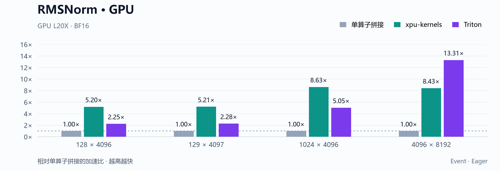
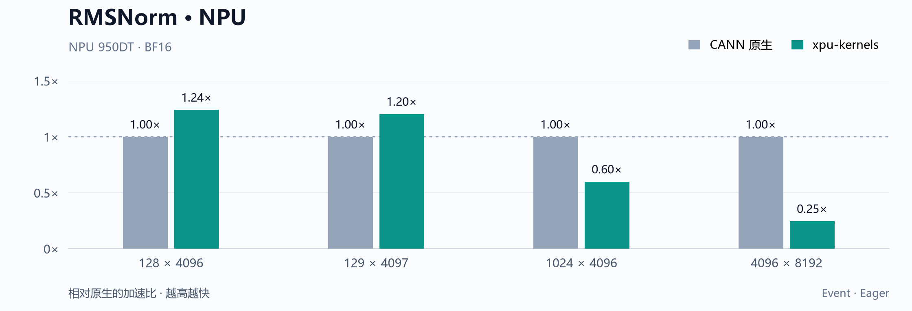

<div align="center">


[快速开始](#quick-start) &nbsp;·&nbsp; [算子](#kernels) &nbsp;·&nbsp; [性能](#benchmarks) &nbsp;·&nbsp; [文档](#documentation) &nbsp;·&nbsp; [AI Skill](skills/xpu-kernels/SKILL.md)

</div>

NVIDIA GPU 与昇腾 NPU 算子库，提供统一 Python 接口、独立数值参考和可复现 benchmark。内核源码、正确性检查与设备采样随代码一起维护。

<a id="kernels"></a>

## Kernels

| 算子 | GPU | NPU | 数据精度 | 文档 |
|---|---|---|---|---|
| **RMSNorm** | CUDA C++ / Triton | Ascend C | FP32 / FP16 / BF16 | [结果与数值约定](docs/performance/README.md) |
| **mHC Post Backward** | — | Ascend C · Cube / Vector | BF16 优化，FP16 原生 | [公式、接口与适用范围](docs/operators/mhc-post-backward.md) |

mHC 优化范围为 BF16、4 条残差流、h_res 存在，token 数 2048–49152，特征宽度为 2560、5120、6144 或 7168。其它受当前接口支持的输入调用 CANN 主线实现。

<a id="benchmarks"></a>

## Benchmarks

<!-- BEGIN homepage-performance -->
柱高为相对同 shape 基线的加速比，**1× 为基线，越高越快**。灰色为基线，青色为本库实现，紫色为 Triton。

### mHC Post Backward


[16 个 shape 与采样](docs/performance/mhc-post-backward.md) · [原始数据](results/benchmarks/mhc-post-backward-msprof.jsonl)

### RMSNorm





<sub>NPU 两种实现的中间舍入顺序不同，分别按对应公式检查。</sub>

[GPU 完整结果](docs/performance/README.md) · [NPU 原生对照](docs/performance/rmsnorm-native.md)

<details>
<summary>测量条件与比较范围</summary>

- **mHC / NPU 950DT**：BF16，基线为 CANN 9.2.0 B096 的主线算子。使用 msprof `Task Duration(us)`，预热 20 次，取 5 次正式采样中位数。展示的 shape 均在优化范围内。
- **RMSNorm / GPU L20X**：BF16，基线为 GPU 单算子拼接。CUDA C++、Triton 和拼接使用相同数值顺序。
- **RMSNorm / NPU 950DT**：BF16，基线为 CANN 原生实现。本库按 Pangu 的中间舍入顺序计算，两者分别对照对应公式；原生更快的 shape 同样保留。
- RMSNorm 使用设备 Event / Eager，预热 20 次，10 批 × 50 次，取批均值的中位数。Event 区间包含 CPU 提交间隙。每张图在同一设备内比较。

[复现方法](docs/benchmarking.md) · [图表数据](docs/assets/performance-chart-data.json)

</details>
<!-- END homepage-performance -->

<a id="quick-start"></a>

## Quick start

需要 Python 3.10+ 和与设备匹配的 PyTorch，在项目私有环境中安装：

```bash
git clone --recurse-submodules https://github.com/JPWang-CS/xpu-kernels.git
cd xpu-kernels
python -m pip install -e '.[gpu,dev]'  # GPU
# NPU：先手动 source CANN，再安装 -e '.[dev]'
```

```python
import torch
from xpu_kernels import rms_norm

x = torch.randn(128, 4096, device="cuda", dtype=torch.bfloat16)
weight = torch.ones(4096, device=x.device, dtype=x.dtype)
y = rms_norm(x, weight)
```

GPU 默认使用 CUDA C++，可用 `implementation="triton"` 切换。NPU 张量使用同一接口。[完整安装、编译依赖与 NPU 示例](docs/getting-started.md)

<a id="documentation"></a>

## Documentation

- [安装与 Python API](docs/getting-started.md)
- [正确性、benchmark 与 profiler](docs/benchmarking.md)
- [安装包与设备验证](docs/validation.md)
- [项目 AI Skill](skills/xpu-kernels/SKILL.md)：让 AI 读取 [AGENTS.md](AGENTS.md)，按项目规范检查环境、构建、验证并保存性能结果。

## License

公共代码采用 [Apache-2.0](LICENSE)；mHC NPU 内核与成本模型保留 [CANN Open Software License 2.0](kernels/include/xpu_kernels/mhc_post_backward/LICENSE)。NPU JIT 运行时使用 [DeepJIT](https://github.com/deepseek-ai/DeepJIT)。[第三方说明](THIRD_PARTY_NOTICES.md)
