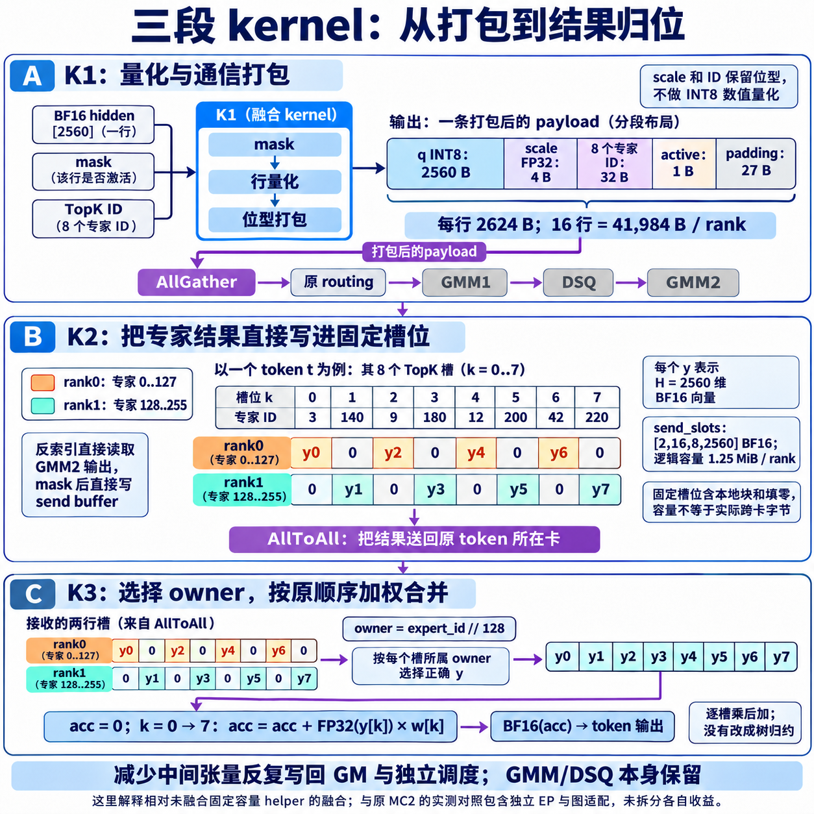
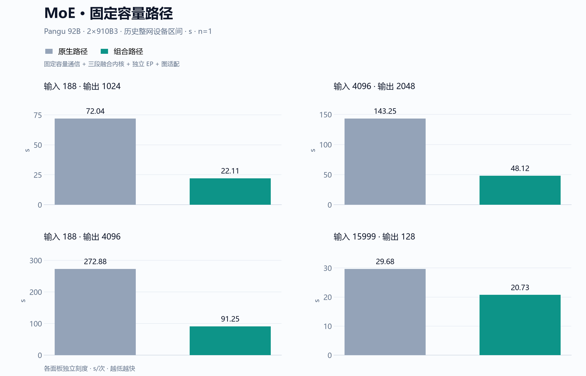

# 按 token 加权合并：设计与数据流

原流程先创建 owner 索引，再 gather 两路结果、转 FP32、加权和归约。融合内核让一个 Vector 核处理一个 token，UB 中保留累加器、当前专家向量和乘积。

```cpp
AscendC::Muls(prodUb, vUb, w[k], h); // each product rounds to FP32
AscendC::Add(accUb, accUb, prodUb, h); // then add in slot order
```

上面的实际代码先用标量权重乘向量，再更新累加器。迁移未改为树归约或 FMA。逐槽结果从全局内存进入 UB，乘权重后更新 FP32 累加器，最后转 BF16 写回。

## 在 MoE 中的位置



图中的 K1、K2、K3 是原实验的三个阶段，依次对应 `fused_quant_payload`、`fused_send_slots`、`fused_owner_combine`。图展示源码数据流；AllGather、原 routing、专家计算和 AllToAll 位于三个接口之间，由组合示例连接。

## 迁移与数值约定

迁移保留 Ascend C 计算主体，将 OPP 的 tiling 指针读取改成 DeepJIT 入口参数构造局部 tiling 结构。Host 层验证 shape、dtype、布局、设备和输出别名，并沿用 PyTorch 当前设备与 stream；构建产物和 JIT 缓存写入项目目录。

独立参考用于核对布局与数值。`fused_owner_combine_golden(..., fp64=True)` 给出未转 BF16 的 FP64 数学结果；默认参考保留逐槽 FP32 舍入。CPU 参考与打包路径已通过，NPU 新 JIT 路径和 GPU 双标杆进入后续验证。

## 历史测量范围

原实验把固定容量集合通信、三个融合内核、独立专家并行（EP）通信组和图模式适配一起测量。

下面是盘古 92B 原整网组合方案的设备业务区间。模型使用 INT8 专家权重和 BF16 hidden，设备为同机双 Ascend 910B3，TP2/DP1/EP2、MTP3、并发 1、FULL_DECODE_ONLY。正式采样窗口内，从首个设备任务开始到最后一个设备任务结束，原生与组合路径各采集一次；取两 rank 中较长的区间，单位秒。



图中选择 S3、S6、S8、S9 四个输入/输出组合，灰色为原生路径，绿色为固定容量组合路径。数据来自历史官方 msprof `task_time` CSV 区间，固定容量集合通信、三个融合内核、独立专家并行（EP）通信组和图适配均包含在设备业务区间内。详细验证状态见下表。

| 输入 / 输出 token 数 | 原生路径（s） | 组合路径（s） |
|---|---:|---:|
| 188 / 1024 | 72.04 | 22.11 |
| 4096 / 1024 | 76.33 | 25.28 |
| 4096 / 2048 | 143.25 | 48.12 |
| 188 / 4096 | 272.88 | 91.25 |
| 15999 / 128 | 29.68 | 20.73 |

## 验证记录

| 项目 | 状态 |
|---|---|
| 8192 / 2048 输出对照 | token 索引 16 出现差异，待排查 |
| 新 JIT NPU 编译、运行与图模式 | 待验证 |
| 精度标准 2.1 与 GPU 双标杆 | 待验证 |
| CPU 参考测试、wheel 打包与资源检查 | 通过 |
