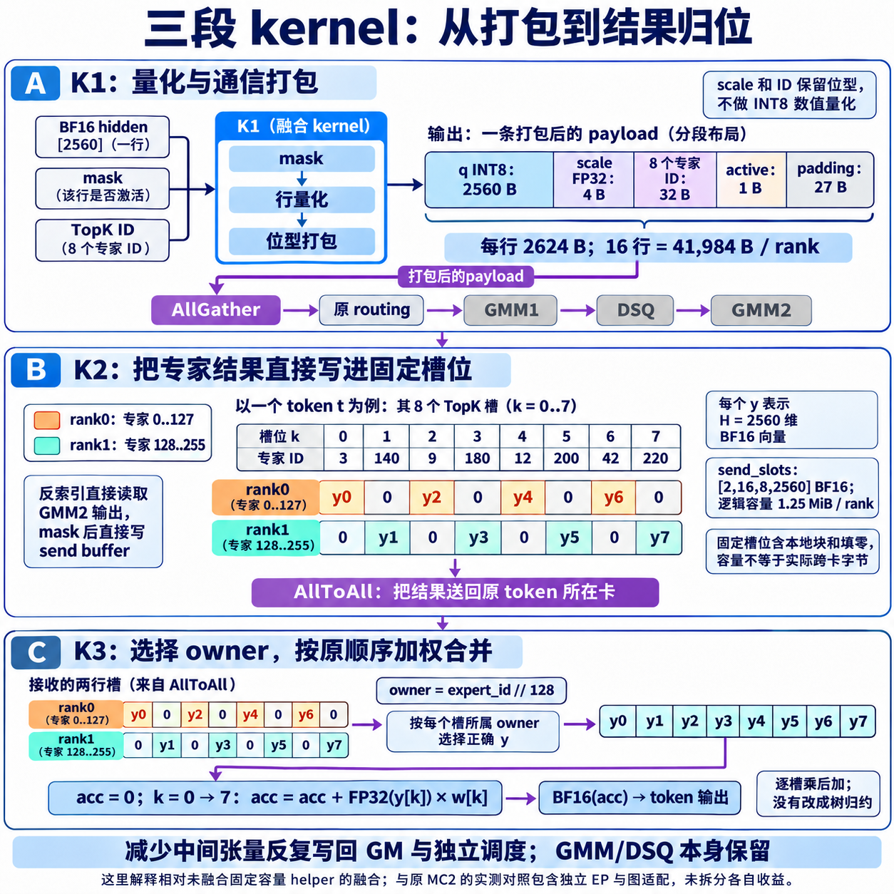

# 量化与通信打包：设计与数据流

原流程分别执行 mask、行量化和 metadata 拼接，产生多个临时张量。融合内核让一个 Vector 核负责一行，在同一次调用中输出完整 payload。

输入从设备全局内存搬入统一缓冲区（Unified Buffer，UB），Vector 指令计算绝对值和最大值；标量辅助函数修正除法舍入，Vector 指令量化特征。payload 尾部按字节写入 scale、专家编号与有效标志，最后搬回全局内存。

```cpp
AscendC::Adds(workUb, workUb, 12582912.0f, h);
AscendC::Adds(workUb, workUb, -12582912.0f, h);
AscendC::Maxs(workUb, workUb, -128.0f, h);
AscendC::Mins(workUb, workUb, 127.0f, h);
```

这两次加法用于最近偶数舍入。随后经过 FP16 中间转换写入 INT8。迁移保留原 `ScalarCrDiv` 修正步骤和计算顺序，并禁止浮点乘加收缩。

## 在 MoE 中的位置



图中的 K1、K2、K3 是原实验的三个阶段，依次对应 `fused_quant_payload`、`fused_send_slots`、`fused_owner_combine`。图展示源码数据流；AllGather、原 routing、专家计算和 AllToAll 位于三个接口之间，由组合示例连接。

## 迁移与数值约定

迁移保留 Ascend C 计算主体，将 OPP 的 tiling 指针读取改成 DeepJIT 入口参数构造局部 tiling 结构。Host 层验证 shape、dtype、布局、设备和输出别名，并沿用 PyTorch 当前设备与 stream；构建产物和 JIT 缓存写入项目目录。

独立参考用于核对布局与数值。量化参考以 FP64 除法后转 FP32，设备实现保留既定的舍入和写包顺序。

## 历史测量范围

组合测量与验证状态统一记录在[按 token 加权合并的历史测量](../fused_owner_combine/optimization.md#历史测量范围)和[验证记录](../fused_owner_combine/optimization.md#验证记录)中。
