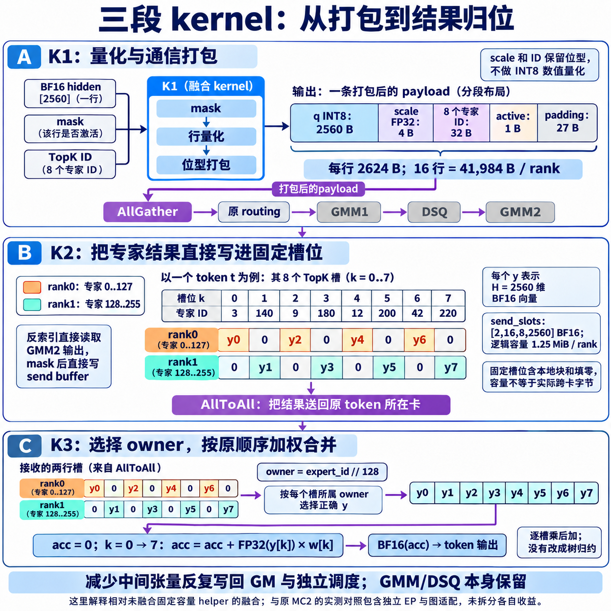

# 专家结果槽位整理：设计与数据流

原流程需要局部专家 mask、索引 gather、填零和 reshape。融合实现把它们合成一次读写：每个 Vector 核处理同一 token 的 8 个选择，32 个核覆盖全部 256 个槽位。

```cpp
const uint32_t t = p / 8;
const bool isLocal = act && (ridV >= expertStart) && (ridV < expertEnd);
// isLocal: read down_proj[inverse_index[p]]; otherwise fill zero.
```

本卡专家结果从全局内存读入 UB，再搬出到固定槽位。输出逻辑容量为 1.25 MiB；它包含发给本卡的数据块和零槽位，不能直接当成跨卡实际传输字节。后续 AllToAll 由调用方执行。

## 在 MoE 中的位置



图中的 K1、K2、K3 是原实验的三个阶段，依次对应 `fused_quant_payload`、`fused_send_slots`、`fused_owner_combine`。图为源码数据流示意，不是硬件采集的流水图。AllGather、原 routing、专家计算和 AllToAll 位于三个接口之间，由组合示例连接。

## 迁移与数值约定

保留原 Ascend C 计算主体，将 OPP 的 tiling 指针读取改成 DeepJIT 入口参数构造局部 tiling 结构。Host 层验证 shape、dtype、布局、设备和输出别名，并沿用 PyTorch 当前设备与 stream；安装过程不覆盖公共 CANN/OPP。

独立参考用于核对布局与数值。`fused_owner_combine_golden(..., fp64=True)` 另外给出未转 BF16 的 FP64 数学结果；默认参考保留逐槽 FP32 舍入。量化参考以 FP64 除法后转 FP32，不把数学参考和特定设备舍入实现混为同一份代码。正式双标杆结果尚待实际 GPU/NPU 执行。

## 历史测量范围

原实验把三个融合内核、固定容量集合通信、独立专家并行（EP）通信组和图模式适配一起测量。这些组合结果不代表本接口的独立加速比。原组合的一例长输出 token 差异仍未关闭；迁移没有扩大其精度覆盖。

本库尚无该 JIT 入口的独立性能数据，因此主页不绘制此算子的性能柱状图。
