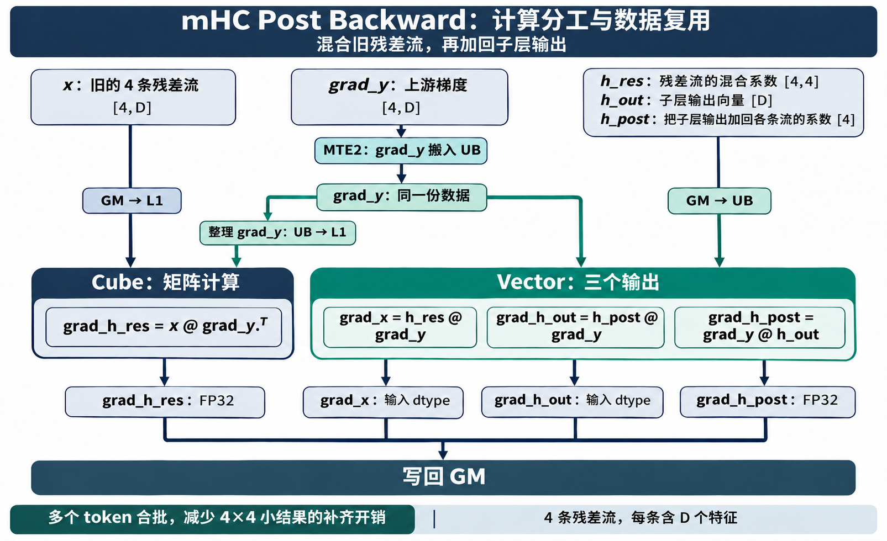
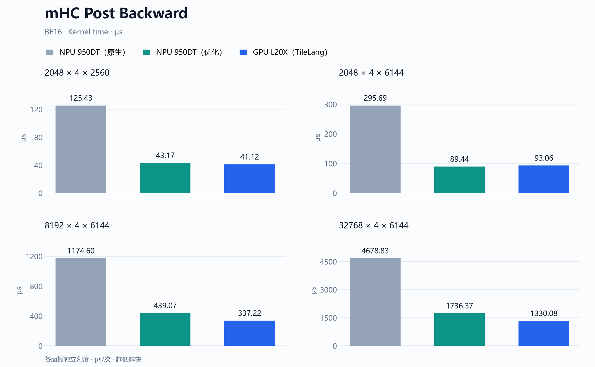

# mHC Post Backward 优化设计

当前实现由 Cube 计算 `grad_h_res`，由 Vector 计算另外三个梯度；两条路径共享从 GM（设备全局内存）搬入的 `grad_y`，Vector 再把 `grad_y` 打包后写入 Cube 使用的 L1（片上一级缓冲）。

## 1. 从公式到数据流

输入及其含义如下：

| 参数 | 简单说明 |
|---|---|
| `x` | 旧的 4 条残差流，每条长度为 `D` |
| `grad_y` | 混合输出收到的上游梯度 |
| `h_res` | `4×4` 混合系数，决定旧流怎样组合成新流 |
| `h_out` | 长度为 `D` 的子层输出，例如 Attention 或 MoE 的输出 |
| `h_post` | 4 个系数，决定子层输出按多大比例加回每条流 |

前向先用 `h_res` 混合旧流，再按 `h_post` 加回子层输出 `h_out`：

$$
Y_{j,d}=\sum_i \mathrm{h\_res}_{i,j}x_{i,d}+\mathrm{h\_post}_{j} \mathrm{h\_out}_{d}.
$$

`i`、`j` 分别是旧流和新流编号，范围为 0 到 3；`d` 是这条向量内的特征位置。

反向分别计算对 `x`、`h_res`、`h_out`、`h_post` 的梯度：

$$
\begin{aligned}
\mathrm{grad\_x}_{i,d} &= \sum_j \mathrm{h\_res}_{i,j}\mathrm{grad\_y}_{j,d},\\
\mathrm{grad\_h\_res}_{i,j} &= \sum_d x_{i,d}\mathrm{grad\_y}_{j,d},\\
\mathrm{grad\_h\_out}_{d} &= \sum_j \mathrm{h\_post}_{j}\mathrm{grad\_y}_{j,d},\\
\mathrm{grad\_h\_post}_{j} &= \sum_d \mathrm{h\_out}_{d}\mathrm{grad\_y}_{j,d}.
\end{aligned}
$$

把公式落到当前 kernel 的数据流：



数据依赖如下：

1. `grad_h_res = x @ grad_y.T` 是唯一需要 Cube 矩阵乘累加的分支。`x` 从 GM 经过 ND2NZ 搬入 L1，再经 L1→L0 后调用 `Mmad`，结果从 L0C 通过 Fixpipe 写回 FP32 的 `grad_h_res`。
2. Vector 在 `ComputeVecVF` 中逐 64 元素块计算 `grad_x`、`grad_h_out`、`grad_h_post`，同时把 `grad_y` 打包成 Cube 需要的 NZ 格式，交给 Cube 的下一块计算。

图中沿着 `grad_y`、`x`、`h_res`、`h_out`、`h_post` 展示数据依赖和跨核同步关系。

## 2. Cube：只承担 `grad_h_res`

### 2.1 为什么这一项适合 Cube

`grad_h_res[i,j] = Σ_d x[i,d]grad_y[j,d]` 对每个 token 是一个 `4×D` 与 `D×4` 的归约，输出是 `4×4` 的 FP32 矩阵。它在 AIC（Cube 侧的矩阵计算核）上执行；当前 Cube 路径将 token 合并成 batch group，并沿 `D` 分成 `l1TileK`/`l0TileK` 两级块，每个 K 块完成一次 16×16×K 的 `Mmad` 累加。Cube 只写 `grad_h_res`，不会计算 `grad_x`。

kernel 入口在 [kernel.hpp](../../../kernels/include/xpu_kernels/mhc_post_backward/kernel.hpp)。当前入口把 `n=4`、`group=4`、`tileD`、`cubeL1K` 和 `cubeBaseK` 写入 tiling，再实例化混合实现：

下面代码框由 `kernel.hpp` 中的常量定义段和 tiling/实例化段组成，中间的容量计算代码省略；保留的代码行均为当前源码原样：

```cpp
constexpr uint64_t n = 4;
constexpr uint64_t group = 4;
constexpr uint64_t batch_per_aiv = group / 2;
constexpr uint64_t ub = XPU_MHC_UB;
constexpr uint64_t width = XPU_MHC_D;
t.n = n;
t.tileD = tile;
t.cubeBatchGroup = group;
t.cubeL1K = tile;
t.cubeBaseK = base_k;
t.cubeKPartitionCount = 1;
t.cubeKPartitionSize = (width + tile - 1) / tile * tile;
AiInfraMhcPostBackward::AiInfraMhcPostBackwardKernelOptimized<XPU_MHC_TYPE, true, false, false> op;
op.Init(grad_y, x, h_res, h_out, h_post, grad_x, grad_h_res, grad_h_out, grad_h_post,
        nullptr, &t, &pipe);
op.Process();
```

上面 `IS_HRES=true` 表示当前分支需要 `h_res` 和 `grad_x`，但它不是把 `grad_x` 交给 Cube；`AiInfraMhcPostBackwardKernelOptimized::Process` 在 AIC 上调用 `ProcessCube()`，在 AIV 上调用 `ProcessVecByHeads()`，两个执行单元协同完成各自的输出。

Cube 的内层代码明确调用 `Mmad`：

```cpp
__aicore__ inline void Compute(const LocalTensor<float>& l0cResult, const LocalTensor<T>& aL0,
    const LocalTensor<T>& bL0, uint32_t size, bool initializeC)
{
    MmadParams params{};
    params.m = 16;
    params.n = 16;
    params.k = size;
    params.disableGemv = true;
    params.cmatrixInitVal = initializeC;
    Mmad(l0cResult, aL0, bL0, params);
}
```

`cube.hpp` 中的 `DataCopyA` 用 `Nd2NzParams` 把 `x` 的行式 token 数据转换成 NZ（Cube 使用的矩阵布局）并搬入 L1；`LoadDataA`/`LoadDataB` 再把 L1 数据送入 L0（Cube 计算单元旁的片上缓冲）；`Mmad` 把结果累加到 L0C（Cube 的累加结果缓冲），`DataCopyOut` 通过 Fixpipe（把 Cube 结果写回 GM 的通路）写出 `grad_h_res`。K 维跨多个块时，`initializeC` 只在一个分段的首块置位，其余块继续累加。

### 2.2 Cube 的搬运与流水

Cube 侧使用两套关键 ping-pong：

- L1 的输入 `x` 和打包后的 `gradY` 各有两个位置，当前块计算时预取下一块；
- L0A、L0B、L0C 交替使用，MTE1、M、FIX 之间通过硬件 event 串起来；
- AIV（Vector 侧的向量计算核）通过 cross-core flag 告诉 Cube：本块 `gradY` 已经由 Vector 打包并写入 L1；Cube 完成后再通知 Vector 可复用对应缓冲。

核心循环保留了“当前块计算、下一块搬运”的顺序。下面是当前源码中预取段的摘录，省略了中间的 cross-core 等待、L0 装载和 Mmad 调用；保留的代码行均为原样：

```cpp
for (uint32_t k = 0; k < cubeParams_.hiddenSize; k += cubeParams_.l1TileK, l1PingPongIndex ^= 1) {
    const uint32_t realK = Min(cubeParams_.l1TileK, cubeParams_.hiddenSize - k);
    WaitFlag<HardEvent::MTE2_MTE1>(eventIdMte2ToMte1_[l1PingPongIndex]);
    if (k + cubeParams_.l1TileK < cubeParams_.hiddenSize) {
        const uint32_t nextL1PingPongIndex = l1PingPongIndex ^ 1;
        WaitFlag<HardEvent::MTE1_MTE2>(eventIdMte1ToMte2_[nextL1PingPongIndex]);
        DataCopyA(xGlobal[offset], k + cubeParams_.l1TileK, count, nextL1PingPongIndex);
        SetFlag<HardEvent::MTE2_MTE1>(eventIdMte2ToMte1_[nextL1PingPongIndex]);
    }
}
```

这段流水的设计目标是让下一块的 GM→L1 搬运尽量落在当前块的 L0 装载和 Cube 计算期间；实际内核时间还取决于 token 数、D、设备时钟、CANN 和输出写回。

### 2.3 四个小结果怎样合成一次计算

单个 token 的输出只有 `4×4`。若每个 token 都单独占用一个 `16×16` Cube 结果块，四个 token 一共要生成四个大块，其中每个大块只取 16 个有效数。

当前配置把 4 个 token 的 x 沿行拼成 `16×D`，把对应的 grad_y 也拼成 `16×D`，一次生成 `16×16` 结果。这个大结果的四个对角 `4×4` 小块，恰好分别是四个 token 所需的 `grad_h_res`；非对角块不写入输出。按结果块计，补齐计算由四个 `16×16` 块减少到一个。这个比值描述 Cube 分块工作量，整算子的实际收益还包含 Vector、搬运和同步。

写回时，Fixpipe 从 Cube 结果缓冲取出这些小块。源码以 `prefix` 表示当前小块前面的列数，复制范围会包含这个前缀；因此按 token、按行倒序写出：

```cpp
for (uint64_t batch = count; batch-- > 0;) {
    const uint64_t columnOffset = batch * cubeParams_.headCount;
    const uint64_t prefix = columnOffset % CUBE;
    fixpipeParams.nSize = prefix + cubeParams_.headCount;
    for (uint64_t row = cubeParams_.headCount; row-- > 0;) {
```

以第二个 token 的第一行为例，`prefix=4`，一次复制包含前面 4 个数和本行 4 个有效数。前缀可能落到第一个 token 的最后一行位置。先写第二个 token，再写第一个 token，后者就会用正确值覆盖这段前缀；行内同样按倒序修正。各 Cube 核负责不同的 token 组，这里的次序解决的是同一组写回范围的重叠。

## 3. Vector：三个输出在同一 VF 主循环中完成

Vector 的入口位于 [vector.hpp](../../../kernels/include/xpu_kernels/mhc_post_backward/vector.hpp)。AIV 的 `ProcessVec` 沿 `D` 按 `tileD` 取块。每块先从 GM 搬入 `gradY` 与 `hOut`，同时预取下一块；随后调用 `ComputeVec<HEADS>`，并把三个 Vector 结果分别写回或保留到归约阶段：

```cpp
ComputeVec<HEADS>(gradY[batch * HEADS * tilingData_->tileD],
    hOut[batch * tilingData_->tileD],
    hResBatch,
    hPostWeights[batch * Align(HEADS, FLOAT_BLOCK_ELEMENTS)],
    gradX[batch * HEADS * tilingData_->tileD], gradHOut[batch * tilingData_->tileD],
    accumulators[batch * HEADS * GRAD_H_POST_ACCUMULATOR_ELEMENTS], packedGradY, size);
```

`ComputeVecVF` 是融合的向量计算函数（VF），对每个 64 元素块做三类事情：

1. 对每个 head 读取 `grad_y`，转换到 FP32 寄存器，并将同一块打包到 `packedGradY`；
2. 用 `\mathrm{h\_post}_{j}` 做 `grad_h_out = Σ_j \mathrm{h\_post}_{j} G_j`，在寄存器内累加后转换回数据 dtype；
3. 用 `h_out` 对每个 head 做 `grad_h_post = Σ_d \mathrm{h\_out}_{d} G_j` 的累加，并用 `h_res` 对每个 row 做 `grad_x = Σ_j \mathrm{h\_res}_{i,j}G_j`，最后转换回数据 dtype。

下面摘自同一函数，省略了函数签名和前置寄存器加载；保留的代码行均为当前源码原样：

```cpp
Reg::Mul(gradHOutReg, gradYReg[0], hPostWeight[0], mask);
#pragma unroll
for (uint16_t head = 1; head < HEADS; ++head) {
    Reg::MulAddDst(gradHOutReg, gradYReg[head], hPostWeight[head], mask);
}
Reg::Cast<T, float, DOWN>(valueB16Reg, gradHOutReg, mask);
Reg::StoreAlign<T, Reg::StoreDist::DIST_PACK_B32>(
    gradHOutAddress + block * 64, valueB16Reg, mask);

#pragma unroll
for (uint16_t row = 0; row < HEADS; ++row) {
    Reg::MulAddDst(gradHPostCorrection[row], gradYReg[row], hOutReg, accumulatorMask);
    Reg::Add(nextGradHPostSum, gradHPostAccumulator[row],
        gradHPostCorrection[row], accumulatorMask);
    Reg::Sub(sumDifference, gradHPostAccumulator[row], nextGradHPostSum, accumulatorMask);
    Reg::Add(gradHPostCorrection[row], sumDifference, gradHPostCorrection[row], accumulatorMask);
    Reg::Move(gradHPostAccumulator[row], nextGradHPostSum);
    if constexpr (IS_HRES) {
        Reg::LoadAlign<float, Reg::LoadDist::DIST_BRC_B32>(hResWeightReg,
            hResAddress + row * HEADS);
        Reg::Mul(gradXReg, gradYReg[0], hResWeightReg, mask);
#pragma unroll
        for (uint16_t col = 1; col < HEADS; ++col) {
            Reg::LoadAlign<float, Reg::LoadDist::DIST_BRC_B32>(hResWeightReg,
                hResAddress + row * HEADS + col);
            if constexpr (std::is_same<T, half>::value) {
                Reg::Mul(gradXProduct, gradYReg[col], hResWeightReg, mask);
                Reg::Add(gradXReg, gradXReg, gradXProduct, mask);
            } else {
                Reg::MulAddDst(gradXReg, gradYReg[col], hResWeightReg, mask);
            }
        }
        Reg::Cast<T, float, DOWN>(valueB16Reg, gradXReg, mask);
        Reg::StoreAlign<T, Reg::StoreDist::DIST_PACK_B32>(
            gradXAddress + row * stride + block * 64, valueB16Reg, mask);
    }
}
```

这里的 `grad_x` 是 Vector 输出；`grad_h_post` 不会在每个小块都立即写回 GM，而是先落到每个 head 的 64 元素累加器，token 结束后再 `ReduceGradHPost` 写出。与此同时，`packedGradY` 通过 `DataCopyGradYToL1` 写入 Cube 侧的 L1 双缓冲，从而形成“一次读入 grad_y，同时服务三个 Vector 输出和 Cube 的下一块输入”的数据流。

## 4. 搬运、队列与跨核同步

Vector 初始化时为 `gradY`、`hOut`、`gradHOut`、`hPost` 和必要的 `gradX` 队列配置双缓冲；`packedGradYQueue_` 也使用两个 buffer。当前实现的关键队列定义是：

```cpp
TQue<QuePosition::VECIN, 1> gradYQueue_, hOutQueue_, hResQueue_, hPostQueue_;
TQue<QuePosition::VECOUT, 1> gradXQueue_, gradHOutQueue_;
TQue<QuePosition::VECOUT, 1> gradHPostQueue_;
TQue<QuePosition::VECOUT, 1> packedGradYQueue_;
```

`DataCopyIn` 使用 `DataCopyPad` 处理最后一个不满 `tileD` 的尾块；`DataCopyOut` 只写回有效 `size`，不把 padding 写进逻辑输出。`ProcessVec` 在下一次计算前预取下一块或下一组 token，之后以 cross-core flag 等待 Cube 对相应 L1 buffer 的消费状态。这样做的重点是减少 GM 往返和等待空洞，而不是改变四个反向公式。

## 5. 精度语义与取舍

当前实现的精度合同分三层：

1. `h_res`、`h_post` 和它们的梯度是 FP32；`x`、`grad_y`、`h_out`、`grad_x`、`grad_h_out` 保持输入数据 dtype（FP16 或 BF16）。
2. Vector 先将输入数据转换为 FP32 寄存器进行乘加，再把 `grad_x`、`grad_h_out` 按公共 API 合同转换回 `T`。Cube 的 L0C 和 `grad_h_res` 使用 FP32。
3. `grad_h_post` 的长维度归约不是简单地把一个 FP32 累加器反复覆盖。源码为每个 head 保留 64 个和与 64 个 correction，并在最终 `ReduceGradHPostVF` 中合并高位部分、残差和 correction；这是为了在不改变输出 dtype 的前提下减轻长归约误差。

计算阶段使用 FP32 累加和补偿，最终仍遵守 `grad_x/grad_h_out` 为输入 dtype、`grad_h_res/grad_h_post` 为 FP32 的接口。正确性验收按四个输出分别对照同一输入的独立 FP64 golden。

## 6. `tileD` 与成本模型

当前 host adapter 在 BF16、NPU 优化范围内才构造 adaptive tiling。它先根据 UB/L1 容量约束得到保守的 `v1_tile`，再把平台查询到的 UB/L1、AIC 数、`baseK` 和当前布局送入 [cost_model.hpp](../../../kernels/include/xpu_kernels/mhc_post_backward/cost_model.hpp) 的确定性候选选择器：

```cpp
in.totalItems=tokens; in.n=4; in.d=d; in.aicCores=runtime.device.get_num_cube_cores();
in.group=4; in.baseK=base_k; in.ubSize=ub; in.l1Size=l1;
in.fixedUb=fixed; in.bytesPerK=per_k; in.v1Tile=v1_tile;
selected_tile=optiling::mhc_adaptive::SelectTileDAdaptive(in).tileD;
```

候选值按 64 元素对齐，包含 `v1_tile`、`baseK` 倍数、有限的 2 次幂、按 `D/2..D/4` 的近均匀切分和容量邻近值。模型分别估计 AIV 的 MTE2/VF/MTE3 链、AIC 的 MTE2/MMAD 链、GM 读写下限以及每 tile 的 cross-core 同步成本；预测收益低于 2% 时保留 `v1_tile`。这些系数属于成本模型的先验/拟合参数，收益判断以实际内核时间为准。

## 7. 精度与配置取舍

- `grad_x`、`grad_h_out` 最终回到输入 dtype，`grad_h_res`、`grad_h_post` 保持 FP32；`grad_h_post` 的和与 correction 共同承担长维度归约的数值稳定性。
- 较大的 `tileD` 减少 D 方向的 tile 数和跨核同步次数，但占用更多 UB/L1；较小的 `tileD` 更容易适配容量和尾块，却会增加流水边界与同步开销。
- `DataCopyPad` 和 VF mask 只处理尾块的有效元素；双缓冲和队列用于重叠搬运与计算，实际内核时间需结合具体设备、shape、dtype、CANN 和采样方法读取。

## 实测结果



<!-- BEGIN measured-performance -->

BF16，单位 **μs/次**。各行采用相同 shape、输入精度和四个输出的检查规则，分别在 NPU 950DT 和 GPU L20X 上运行。NPU 原生调用 CANN 包主线 `aclnnMhcPostBackward`，优化调用本库内核；GPU 调用 DeepSeek TileKernels 的 TileLang 实现。

### 内核时间

NPU 使用 msprof `MIX_AIC / Task Duration(us)`；GPU 使用 Nsight Compute `gpu__time_duration.sum`，从 ns 换算为 μs。每项预热 20 次，保留随后 5 次内核时间，表中为中位数。使用同一组缓冲区连续执行，保持设备原有时钟；NCU 使用 kernel replay，cache-control 和 clock-control 均为 none。

| Shape | NPU 950DT（原生） | NPU 950DT（优化） | GPU L20X（TileLang） |
|---|---:|---:|---:|
| 2048 × 4 × 2560 | 125.430 | 43.167 | 41.120 |
| 2048 × 4 × 5120 | 205.597 | 75.942 | 78.816 |
| 2048 × 4 × 6144 | 295.689 | 89.442 | 93.056 |
| 2048 × 4 × 7168 | 329.050 | 120.865 | 104.864 |
| 8192 × 4 × 2560 | 502.189 | 187.783 | 143.136 |
| 8192 × 4 × 5120 | 815.806 | 367.347 | 281.248 |
| 8192 × 4 × 6144 | 1174.600 | 439.071 | 337.216 |
| 8192 × 4 × 7168 | 1304.922 | 522.717 | 394.592 |
| 32768 × 4 × 2560 | 2000.422 | 738.546 | 550.816 |
| 32768 × 4 × 5120 | 3242.825 | 1455.092 | 1106.240 |
| 32768 × 4 × 6144 | 4678.831 | 1736.369 | 1330.080 |
| 32768 × 4 × 7168 | 5199.662 | 2076.415 | 1558.304 |
| 2 × 1024 × 4 × 6144 | 295.395 | 89.943 | 89.888 |
| 3 × 1024 × 4 × 6144 | 445.595 | 172.502 | 132.256 |
| 2 × 4096 × 4 × 6144 | 1174.741 | 442.260 | 336.544 |
| 3 × 8192 × 4 × 6144 | 3513.410 | 1337.927 | 998.720 |

三维 shape 为 T×N×D，四维为 B×S×N×D，N=4，四维输入的 token 数为 B×S。各设备使用相同输入分布；设备随机数实现不同，各设备内的原生与优化共享输入。

### 正确性与运行环境

16 个 shape 均在首尾及内部共六个 token 上用独立 CPU FP64 公式检查四个输出。设备单元测试另检查代表 shape 的全量输出、三维/四维输入、非默认 stream 和输出复用。GPU 四个输出依次为 grad_x、grad_h_res、grad_h_out、grad_h_post，已与上游返回顺序逐项对应。

| 项目 | NPU | GPU |
|---|---|---|
| 设备 | Ascend950DT_9582 | NVIDIA L20X，CC 9.0 |
| PyTorch | 2.9.0+cpu | 2.13.0+cu126 |
| 运行环境 | torch_npu 2.9.0.post7.dev20260817，CANN 9.2.0 B096 | CUDA runtime 12.6，NVCC 12.8，TileLang 0.1.15 |
| 原始内核样本 | 原生 400 条、优化 400 条 | TileLang 400 条 |

### 复现

在对应设备环境中先执行正确性测试，再采集重复 Event 调用时间及官方 profiler 内核时间：

```bash
python -m xpu_kernels.cli test --device cuda --operator mhc_post_backward
python -m xpu_kernels.cli bench --device cuda --operator mhc_post_backward \
  --warmup 20 --batches 10 --iterations-per-batch 50 \
  --output results/benchmarks/mhc-post-backward-gpu-tilelang.jsonl
python tools/profile_mhc_gpu.py --output results/profiles/mhc-gpu --records results/benchmarks/mhc-post-backward-gpu-ncu.jsonl
```

NPU 手动 source 已选择的 CANN 后运行：

```bash
python -m xpu_kernels.cli test --device npu --operator mhc_post_backward
python -m xpu_kernels.cli bench --device npu --operator mhc_post_backward \
  --warmup 20 --batches 10 --iterations-per-batch 50 \
  --output results/benchmarks/mhc-post-backward-npu-mainline.jsonl
python tools/profile_mhc_matrix.py --output results/profiles/mhc-matrix
```

Event 测试在每次调用中分配四个输出，记录设备 stream 的调用区间；CPU 提交间隙可能包含在内。上表采用独立 profiler 的内核时间。每次采集使用新的 profiler 输出目录。

### 数据

- [NPU 内核统计](../../../results/benchmarks/mhc-post-backward-msprof.jsonl) · [原生样本](../../performance/data/mhc-mainline-native.csv) · [优化样本](../../performance/data/mhc-mainline-optimized.csv)
- [GPU 内核统计](../../../results/benchmarks/mhc-post-backward-gpu-ncu.jsonl) · [NCU 样本](../../performance/data/mhc-gpu-tilelang.csv)
- Event 调用记录：[NPU](../../../results/benchmarks/mhc-post-backward-npu-mainline.jsonl) · [GPU](../../../results/benchmarks/mhc-post-backward-gpu-tilelang.jsonl)
- [算子公式、适用范围与调用示例](README.md)

### 结果怎么读

2048 × 4 × 6144：原生 295.69 μs，优化 89.44 μs，加速 3.31×。32768 × 4 × 6144：原生 4678.83 μs，优化 1736.37 μs，加速 2.69×。这些是同一 NPU 上完整内核的对照结果，包含合批、grad_y 共享、Vector 融合、分块和流水的共同作用。GPU 列保留对应硬件的独立实测，便于按 shape 查看不同实现的表现。

<!-- END measured-performance -->
