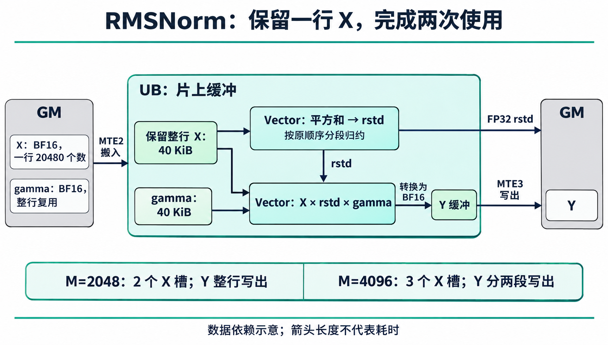
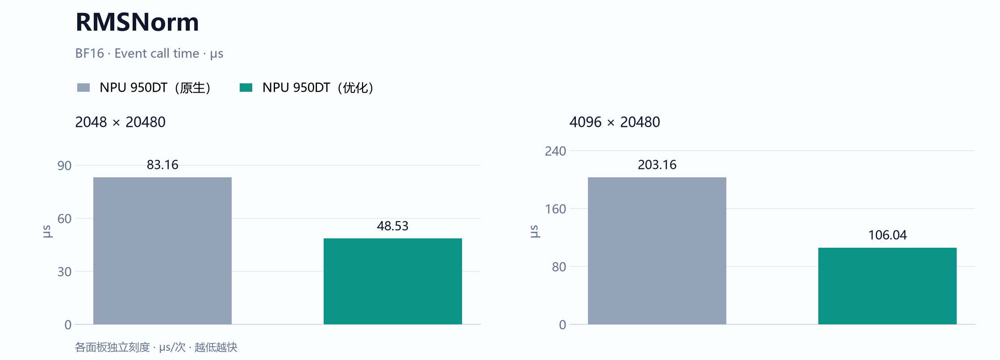

# RMSNorm 优化设计

[接口与适用范围](README.md) · [实测结果](#实测结果)

当前优化处理 Ascend 950 上的 BF16 输入，行宽为 20480，行数为 2048 或 4096。主线分段实现先读取 X 计算平方和，得到 `rstd` 后再次读取 X 计算 Y。优化把一整行 BF16 X 留在片上缓冲中，平方和与 Y 都使用这份数据，再根据行数安排预取和输出缓冲。

## 一行数据为什么要使用两次

公式可以按依赖分为两步：

$$
\sum_d x_d^2 \longrightarrow r=\frac{1}{\sqrt{(\sum_d x_d^2)/D+\varepsilon}},
\qquad (X,r,\gamma)\longrightarrow Y.
$$

算平方和时会读完一行，但这时还没有最终的 `rstd`。等整行平方和合并完成后，才能用同一个 `rstd` 计算这一行的输出。原生分段路径将 UB 用于当前分段及计算临时量；输出阶段再读 X。保留整行的作用，是把第二次使用改为读取片上已有数据。



GM 是设备全局内存，UB 是 Vector 核内的片上缓冲。MTE2 将数据搬入 UB；Vector 完成平方和、开根号、除法与乘法；MTE3 写回 Y 和汇总后的 rstd。图中的第二条 X 箭头表示复用同一行，横向距离不表示设备耗时。

## 先算空间，再决定怎样保留 X

20480 个 BF16 元素占 `20480×2=40960` 字节，即 **40 KiB**。同样宽度的 FP32 临时数组占 80 KiB。优化保留 BF16 X，计算到哪里就把相应数据转换到寄存器中的 FP32，避免额外保留整行 FP32 X。

统一缓冲区预算如下。KiB 按 1024 字节计算。

| 缓冲用途 | M=2048 | M=4096 |
|---|---:|---:|
| X 行槽 | 2×40 KiB | 3×40 KiB |
| gamma | 40 KiB | 40 KiB |
| Y 输出缓冲 | 2×40 KiB | 2×20 KiB |
| 归约工作区、三级小计、rstd 等 | 4.75 KiB | 4.75 KiB |
| 合计 | **204.75 KiB** | **204.75 KiB** |

两种配置使用相同的总空间。M=4096 将两个 Y 缓冲从整行改为半行，省下 40 KiB，用于第三个 X 槽。这个槽可以保存更后面的一行，使搬入工作更早发出。

主机侧按行数选择配置，计算公式和归约顺序共用：

```cpp
const int slots = rows == 2048 ? 2 : 3;
```

每次启动使用 64 个 Vector 核。2048 行对应每核 32 行，4096 行对应每核 64 行；每核负责一段连续行。gamma 在每核进入行循环前加载一次，供这些行共用。

## 预取怎样与计算衔接

两行槽配置先搬入第一行，再在处理当前行时发出下一行的搬入。三行槽配置先准备前两行，循环中提前搬入第三行。三行槽的关键代码是：

```cpp
CopyInX(nextRow++);  // prime row 0
if (nextRow < rowWork) {
    CopyInX(nextRow++);  // prime row 1 before taking row 0
}
uint32_t rstdCount = 0;
while (rstdCount < rowWork) {
    LocalTensor<DX> xLocal = inQueueX.DeQue<DX>();
    if (nextRow < rowWork) {
        CopyInX(nextRow++);
    }
```

以当前处理第 0 行为例：第 0 行已经取到 `xLocal`，第 1 行在另一个槽位里，第 2 行的搬运也已发出。随后 Vector 用第 0 行算平方和及 Y。MTE2 和 Vector 是不同的硬件管线，这样的提交顺序给两者留下重叠机会。

行槽仍需遵守使用顺序。当前 X 行既用于归约，也用于 Y，完成这两个消费者后才能释放：

```cpp
ComputeFormerForRow(currentWork, xLocal);
ComputeRstdAndPack(currentWork, resultRows, rstdCount);
PipeBarrier<PIPE_V>();

ComputeYForRow(xLocal, gammaLocal, currentWork, rstdCount);
inQueueX.FreeTensor(xLocal);
```

队列负责搬运和消费者之间的同步。增加槽位改变的是能够提前准备多少行；每行的 `平方和 → rstd → Y` 依赖保持不变。

## 整行保留与分段归约是两件事

X 整行留在 UB 后，归约仍按原来的分段顺序处理：

| X 范围 | 元素数 | 代码中的归约参数 |
|---|---:|---:|
| `[0,8192)` | 8192 | `powerSplit=4096` |
| `[8192,12288)` | 4096 | `powerSplit=4096` |
| `[12288,20480)` | 8192 | `powerSplit=8192` |

对应代码保留了三个处理调用及小计合并的位置：

```cpp
ComputeFormerHandle(tempLocal, xLocal, workLocal, 0, 0, 8192, 4096);
ComputeFormerHandle(tempLocal, xLocal, workLocal, 8192, 1, 4096, 4096);
ComputeSum(level1Local, tempLocal, level1, SUM_COUNT);
++level1;
ComputeMultiLevelReduce(level1Local, level2Local, level3Local, level1, level2, level3);

ComputeFormerHandle(level1Local, xLocal, workLocal, 12288, level1, 8192, 8192);
```

`8192+4096+8192` 是处理这行数据的顺序，三个区间恰好覆盖 20480 个元素。每段生成的小计写入 level 缓冲，再按既定层次合并成整行平方和。留整行减少了全局内存读数；保留这条归约路径则延续已验证的累加顺序。

## rstd 直接保留在 Vector 路径中

整行平方和得到后，先乘 `1/D`，加 epsilon，再执行 `sqrt` 与除法：

```cpp
Muls(srcReg, srcReg, avgFactor, maskReg);
Adds(dstReg, srcReg, epsilon, maskReg);
Sqrt(sqrtReg, dstReg, maskReg);
Duplicate(srcReg, float(1.0), maskReg);
Div(dstReg, srcReg, sqrtReg, maskReg);
DataCopy(rstdLocalAddr, dstReg, maskReg);
DataCopy<float, StoreDist::DIST_FIRST_ELEMENT_B32>(resultRowsAddr + row, dstReg, maskOne);
```

最后两次写入保存的是同一个 `rstd`：一份供当前行的 Y 计算读取，另一份写入按行打包的 rstd 缓冲。整批行处理完，再写回这个缓冲。这样减少了逐行取出标量、写回标量以及 Vector 与 Scalar 之间交接的步骤。

## Y 为什么有整行和半行两种写法

Y 阶段把保留的 X、gamma 和当前行的 rstd 送入 `ComputeLatterY`。该函数将 X 和 gamma 转为 FP32，按 `X×rstd`、再乘 gamma 的顺序计算，最后转换到 BF16。

两行槽配置每次输出 20480 个元素；三行槽配置每次输出 10240 个元素，一行分两次完成。分段只改变输出缓冲的大小和搬运次数，每个元素仍应用同一个 rstd。调用和写出顺序为：

```cpp
ComputeLatterY<DX, DG>(xView, gammaView, yLocal, rstdLocal, 0, calCount,
                       static_cast<uint8_t>(IS_GEMMA));
outQueueY.EnQue<DX>(yLocal);
yLocal = outQueueY.DeQue<DX>();
DataCopyImpl<DX>(yGm[static_cast<uint64_t>(row) * numCol + offset], yLocal, 1, count, 0, 0);
outQueueY.FreeTensor(yLocal);
```

因此，三行槽配置用较小的 Y 缓冲换取更早的 X 预取。它增加了 Y 的分段次数，收益取决于这笔交换在目标行数下能否减少等待。最终按两个目标 shape 分别选择配置。

## 从流量估算看收益来源

先只计算 X 和 Y，省略 gamma、rstd 与缓存命中影响。BF16 每元素 2 字节：

$$
B_{\mathrm{分段两遍读X}}\approx 6MD,
\qquad B_{\mathrm{保留X}}\approx 4MD.
$$

对 2048×20480，读两遍 X、写一遍 Y 对应 240 MiB，保留 X 后对应 160 MiB；4096×20480 则由 480 MiB 降到 320 MiB。这是程序请求的数据量估算，实际 HBM 流量还取决于缓存。

只按这部分流量比较，比值为 1.5。实测的完整实现同时包含 rstd 打包、预取和 Y 缓冲调整，收益应结合这些改动一起解释。下面的 Event 结果衡量整次调用，设备流水用于观察搬运、计算及等待的分布。

## 归约精度决定哪些方案保留

归约的加法顺序会影响 FP32 舍入。此前尝试用四条或八条较长累加链收集平方和；42 组测试中，两种方案都在 5 组输入的 `rstd` 上未通过标准 2.1，其最大 RMSE 误差比约为 4.70 和 2.20。这两种长链实现没有纳入最终配置。

最终实现保留已验证的分段归约顺序，并分别检查 BF16 Y 和 FP32 rstd。输出 Y 转为 BF16 后可能掩盖部分 rstd 变化，因此两个输出各自验收。

gamma 预转为 FP32 会额外占用 40 KiB UB，整行 FP32 X 则额外占用 80 KiB。它们都要与预取槽位、Y 缓冲竞争片上空间。当前设计优先消除第二遍 X 读取并保留搬运流水，gamma 在计算时转换；这些预转方法保留为设计讨论项。

## 实测结果



<!-- BEGIN measured-performance -->

**Ascend950DT_9582 · BF16 · μs/次**。原生实现调用测试时 CANN 包中的 `torch_npu.npu_rms_norm`，优化实现通过本库公开的 `rms_norm` 入口调用。

| Shape | 原生 | 优化 | 加速比 |
|---|---:|---:|---:|
| 2048 × 20480 | 83.16 | 48.53 | 1.71× |
| 4096 × 20480 | 203.16 | 106.04 | 1.92× |

### 测量条件

同一物理卡、连续输入、`eps=1e-5`。每个 shape、每种实现测量两轮；每轮预热 20 次，随后采集 7 批，每批调用 100 次。表中数值为两轮共 14 个批均值的中位数。两种实现均在每次调用中分配 BF16 `Y` 与 FP32 `rstd`，使用同一框架 stream；公开接口返回 `Y`。

Event 测量设备 stream 上的调用区间，其中可能包含 CPU 提交间隙。官方 profiler 的内核时间单独用于分析。

环境为 PyTorch 2.9.0+cpu、torch_npu 2.9.0.post7.dev20260817、CANN 9.2.0 B096。原生采集命中 `RmsNorm_normal_all_bf16_high_performance_2001`；该批记录的优化内核名为 `xpu_rms_norm_cann`，当前统一入口为 `rms_norm`。

### 数值与适用范围

公式为 `rstd = 1/sqrt(mean(X²)+eps)`、`Y = cast(X*rstd*gamma)`，最后转换到输入精度。42 组输入共 84 项输出检查通过精度标准 2.1；其中 12 组执行目标优化，30 组执行主线。FP64 参考值由精确 BF16 输入重新计算，GPU 标杆来自已保存的同输入 NVIDIA L20X 实跑结果。

`M=2048` 使用两个 X 行槽与整行 Y；`M=4096` 使用三个 X 行槽与两段 Y。其他输入由 CANN 主线处理。完整接口见 [RMSNorm](README.md)。

### 复现

```bash
python -m xpu_kernels.cli bench --device npu --native-reference \
  --implementations optimized --shapes 2048x20480,4096x20480 \
  --dtypes bfloat16 --warmup 20 --batches 7 --iterations-per-batch 100
```

[逐批性能记录](../../../results/benchmarks/rmsnorm-npu-cann.jsonl) · [精度检查结果](../../performance/data/rmsnorm-cann-precision21.json) · [测量方法](../../benchmarking.md)

<!-- END measured-performance -->
